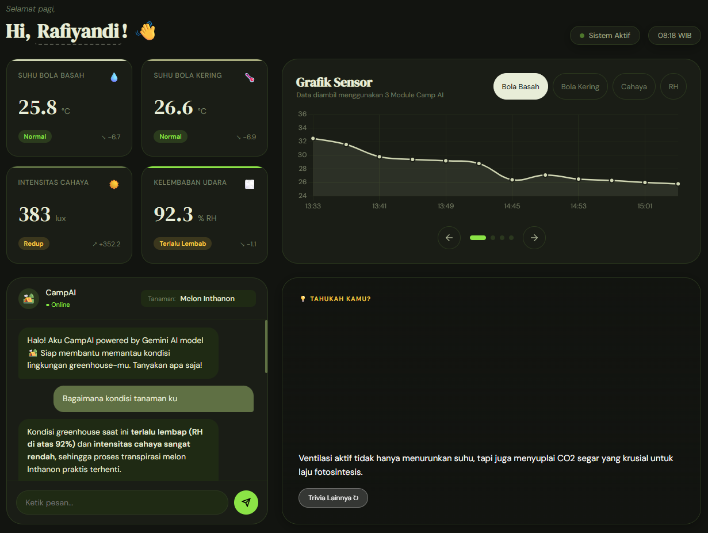
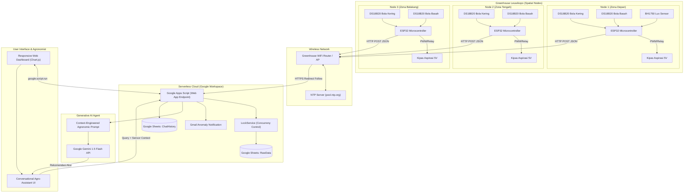

# CAMP-AI: Low-Cost Controlled Environment Monitoring Platform Based on IoT and Generative AI

[](https://www.espressif.com/)
[](https://developers.google.com/apps-script)
[](https://ai.google.dev/)
[](https://www.chartjs.org/)
[](LICENSE)
[](https://ipb.ac.id/)

> **Proyek Capstone / Tugas Akhir Terintegrasi**  
> **Departemen Teknik Mesin dan Biosistem, Fakultas Teknologi Pertanian, IPB University**  
> *Greenhouse Leuwikopo, Institut Pertanian Bogor, 2026*

---

## 👥 Tim Peneliti & Pengembang (Kelompok 2)

| Nama Mahasiswa | NIM | Peran Utama |
| :--- | :--- | :--- |
| **Rafiyandi Putra Pasha** | **F1401221085** | Arsitektur IoT, Firmware ESP32, Integrasi Serverless GAS & Gemini AI |
| **Eliza Nurul Azhar** | **F1401221051** | Analisis Agronomi, Desain Enclosure 3D CAD, Validasi Lapangan |
| **Dian Khairani** | **F1401221078** | Pengujian Kalibrasi Sensor, Pemodelan Psikrometrik, Analisis Ekonomi |

**Dosen Pembimbing:**
1. **Dr. Ir. Radite Praeko Agus Setiawan, M.Agr.** (NIP: 196808121993021001)
2. **Dr. Ir. Supriyanto, S.T.P., M.Kom., IPM.** (NIP: 197203251998021001)

---

## 📋 Daftar Isi
1. [Ringkasan Eksekutif](#-ringkasan-eksekutif)
2. [Latar Belakang & Masalah](#-latar-belakang--masalah)
3. [Arsitektur Sistem](#-arsitektur-sistem)
4. [Formulasi Matematika Kelembapan Psikrometrik](#-formulasi-matematika-kelembapan-psikrometrik)
5. [Skematik Hardware & Pinout](#-skematik-hardware--pinout)
6. [Desain Mekanikal & Enclosure 3D](#-desain-mekanikal--enclosure-3d)
7. [Infrastruktur Serverless Google Apps Script](#-infrastruktur-serverless-google-apps-script)
8. [Integrasi Gemini 1.5 Flash (Context Engineering)](#-integrasi-gemini-15-flash-context-engineering)
9. [Dashboard Web Interaktif](#-dashboard-web-interaktif)
10. [Hasil Pengujian & Validasi Lapangan](#-hasil-pengujian--validasi-lapangan)
11. [Analisis Tekno-Ekonomi (BOM & Kelayakan)](#-analisis-tekno-ekonomi-bom--kelayakan)
12. [Panduan Instalasi & Deployment](#-panduan-instalasi--deployment)
13. [Lisensi & Sitasi](#-lisensi--sitasi)

---

## 🚀 Ringkasan Eksekutif

**CAMP-AI** (*Controlled-Atmosphere Microclimate Platform with Artificial Intelligence*) adalah sistem pemantauan lingkungan mikroklimat presisi berbiaya rendah (*low-cost*) yang dirancang untuk pertanian lingkungan terkendali (*Controlled Environment Agriculture* / CEA), khususnya budidaya hortikultura bernilai tinggi seperti **Melon Inthanon**.

Sistem ini memecahkan kelemahan umum sensor kelembapan kapasitif konvensional (misalnya DHT11/DHT22/SHT2x) yang sering mengalami saturasi, drift permanen, dan kerusakan membran pada kondisi RH tinggi (>85%) dan kondensasi greenhouse tropis. CAMP-AI mengadopsi **prinsip Psikrometer Assmann berventilasi buatan** menggunakan sepasang termistor kedap air DS18B20 yang higienis, tahan lama, dan mudah dikalibrasi, dipadukan dengan **Google Apps Script (Serverless Cloud)** dan model fondasi **Google Gemini 1.5 Flash** untuk menyajikan rekomendasi agronomi berbasis data waktu nyata secara otomatis.



---

## 🔍 Latar Belakang & Masalah

Greenhouse di wilayah tropis seperti Indonesia menghadapi tantangan iklim mikro yang dinamis:
- **Fluktuasi Suhu Ekstrem:** Suhu siang hari dapat melonjak melampaui 38°C akibat efek rumah kaca tertutup.
- **Kelembapan Ekstrem & Kondensasi:** Pada malam dan pagi hari, RH kerap menyentuh 95–100%, memicu infeksi patogen jamur seperti embun tepung (*powdery mildew* - *Podosphaera xanthii*) dan busuk batang berlendir (*gummy stem blight*).
- **Kelemahan Sensor Kapasitif:** Sensor RH berbasis polimer film tipis mengalami *sensor degradation*, histeresis tinggi, dan kegagalan pembacaan saat embun menempel pada permukaan chip.
- **Biaya Stasiun Cuaca Konvensional:** Alat stasiun mikroklimat standar riset berkisar antara Rp 15.000.000 – Rp 40.000.000, tidak terjangkau bagi petani skala komersial menengah maupun riset mahasiswa.

**Solusi CAMP-AI:**
1. Menggunakan **psikrometer aspirasi terkontrol** (dua sensor DS18B20 suhu bola kering dan suhu bola basah berventilasi kipas DC) seharga kurang dari Rp 250.000 per node.
2. Formulasi perhitungan RH mengacu pada **Standar Perka BMKG No. 04 Tahun 2026**.
3. Sistem **multi-node terdistribusi** (Depan, Tengah, Belakang) untuk memetakan gradien suhu dan kelembapan horizontal sepanjang greenhouse.
4. Konsultasi agronomi real-time via **Generative AI LLM** yang secara kontekstual memahami status sensor terkini.

---

## 🏗️ Arsitektur Sistem

CAMP-AI menggunakan topologi modular berbasis edge-to-cloud:



### Siklus Kerja Node ESP32
Setiap interval transmisi (default: 15 menit), node menjalankan state machine:
1. **Wakeup & Stabilisasi:** Relay menyalakan kipas aspirasi selama **5 detik** agar sirkulasi udara mencapai kecepatan tunak di atas kain basah.
2. **Window Sampling 60 Detik:** Selama 60 detik, sensor membaca suhu bola kering ($T_d$), suhu bola basah ($T_w$), dan intensitas cahaya ($Lux$) setiap 5 detik (12 sampel).
3. **Data Filtering & Averaging:** Menyaring nilai anomali `DEVICE_DISCONNECTED_C` (-127°C) dan `POR` (85°C), kemudian menghitung rata-rata aritmetika.
4. **Kalkulasi Psikrometrik BMKG:** Menghitung $RH$ dari $T_d$ dan $T_w$ terukur.
5. **Transmisi HTTP POST:** Mengirim payload JSON ke URL Google Apps Script.
6. **Fan Shutdown & Sleep:** Mematikan kipas untuk menghemat daya dan menjaga air di reservoir tidak cepat habis.

---

## 🧮 Formulasi Matematika Kelembapan Psikrometrik

Metode pengukuran kelembapan relatif psikrometer mengacu pada kesetimbangan termodinamika antara kalor sensibel yang berpindah dari udara ke sensor basah dan kalor laten penguapan air dari sumbu basah ke udara sekitar.

### 1. Tekanan Uap Jenuh (Formula Tetens / BMKG)
Tekanan uap air jenuh pada temperatur $T$ (°C) dihitung dengan persamaan eksponensial standar:
$$e_s(T) = 0.6108 \exp\left( \frac{17.27 \times T}{T + 237.3} \right) \quad [\text{kPa}]$$

Di mana:
- $e_s(T_d)$ adalah tekanan uap air jenuh pada suhu bola kering $T_d$.
- $e_s(T_w)$ adalah tekanan uap air jenuh pada suhu bola basah $T_w$.

### 2. Tekanan Uap Aktual (Persamaan Sprung / Assmann)
Tekanan uap air aktual di udara ($e_a$) dihitung dengan memperhitungkan depresi bola basah $(T_d - T_w)$:
$$e_a = e_s(T_w) - A \times P \times (T_d - T_w) \quad [\text{kPa}]$$

Parameter:
- $P = 101.325\text{ kPa}$ (Tekanan atmosfer permukaan laut).
- $A$ adalah konstanta psikrometrik yang bergantung pada kecepatan aliran udara melewati sensor. Berdasarkan **Peraturan Kepala BMKG No. 04 Tahun 2026**:
  $$\text{Untuk Psikrometer Berventilasi Buatan (Kipas Aspirasi): } A = 0.7947 \times 10^{-3} = 0.0007947 \text{ }^\circ\text{C}^{-1}$$

### 3. Kelembapan Relatif (Relative Humidity - RH)
$$\text{RH} = \left( \frac{e_a}{e_s(T_d)} \right) \times 100\%$$

> [!IMPORTANT]
> **Temuan & Perbaikan Bug Konstanta Psikrometrik Firmware:**  
> Pada versi draf awal firmware, konstanta psikrometrik tertulis `const float A = 0.00799;` (10 kali lipat lebih besar akibat salah penempatan koma desimal). Kesalahan ini menyebabkan pengurangan tekanan uap berlebih hingga nilai RH terbaca **19.55%** pada kondisi aktual $T_d = 28^\circ\text{C}, T_w = 25^\circ\text{C}$ (seharusnya **77.41%**). Bug ini telah diperbaiki secara tuntas pada file [Capstone.ino](Capstone/Capstone.ino#L78-L98).

---

## 🔌 Skematik Hardware & Pinout

### Daftar Komponen (Bill of Materials)
| No | Komponen | Tipe / Spesifikasi | Jumlah per Node | Estimasi Harga (IDR) |
| :---: | :--- | :--- | :---: | :---: |
| 1 | Mikrokontroler | ESP32-WROOM-32 30-Pin NodeMCU | 1 unit | Rp 55.000 |
| 2 | Sensor Suhu Basah & Kering | DS18B20 Waterproof Probe Stainless Steel | 2 unit | Rp 36.000 |
| 3 | Sensor Intensitas Cahaya | GY-302 BH1750 (I2C) | 1 unit (Node 1) | Rp 16.000 |
| 4 | Aktuator Sirkulasi | Mini DC Blower Fan 5015 5V / 4010 5V | 1 unit | Rp 15.000 |
| 5 | Modul Penggerak Kipas | Relay 1-Channel 5V Optocoupler / Transistor | 1 unit | Rp 6.000 |
| 6 | Resistor Pull-up | Resistor Metal Film 4.7 kΩ (OneWire Bus) | 2 pcs | Rp 1.000 |
| 7 | Catu Daya & Kabel | Adaptor 5V 2A + Kabel Micro USB | 1 set | Rp 30.000 |
| 8 | Wadah & Sumbu Basah | Kain katun kasa higroskopis + Laci penampung | 1 set | Rp 10.000 |
| 9 | Enclosure 3D Print | PLA+ Filament (Bagian Atas, Bawah, Laci) | ~180 gram | Rp 45.000 |
| **Total** | **Biaya per Node** | | | **~Rp 214.000** |

### Tabel Pinout Koneksi ESP32
```
┌─────────────────────────────────────────────────────────────┐
│                       ESP32 DEVKIT V1                       │
│                                                             │
│   GPIO19 ─────────────────── DS18B20 Suhu Bola Kering (DQ)   │
│   GPIO16 ─────────────────── DS18B20 Suhu Bola Basah (DQ)    │
│   GPIO26 ─────────────────── Relay / Transistor Driver Kipas │
│   GPIO21 (SDA) ───────────── BH1750 SDA (Khusus Node 1)      │
│   GPIO22 (SCL) ───────────── BH1750 SCL (Khusus Node 1)      │
│   3V3 / 5V ───────────────── VCC Sensor & VCC Relay          │
│   GND ────────────────────── Common Ground                   │
└─────────────────────────────────────────────────────────────┘
```

> [!NOTE]
> Kedua jalur data DS18B20 (GPIO19 dan GPIO16) masing-masing dipasang resistor *pull-up* 4.7 kΩ ke pin 3.3V untuk memastikan stabilitas protokol transmisi 1-Wire.

---

## 📐 Desain Mekanikal & Enclosure 3D

Desain fisik dirancang khusus dengan perangkat lunak CAD untuk memastikan isolasi termal, aliran aerasi laminar di atas sensor bola basah, dan kemudahan penggantian air distilasi.

Berkas model 3D siap cetak (*Stereolithography* / STL) tersedia pada direktori [`Desain/`](Capstone/Desain):
1. [`Bagian Atas_Capstone.stl`](Capstone/Desain/Bagian%20Atas_Capstone.stl) — Rumah pelindung atas dengan kisi-kisi pembuangan udara dan dudukan sensor cahaya BH1750.
2. [`Bagian Bawah_Capstone.stl`](Capstone/Desain/Bagian%20Bawah_Capstone.stl) — Kompartemen utama yang memisahkan modul mikrokontroler dari ruang basah sensor.
3. [`Laci_Capstone.stl`](Capstone/Desain/Laci_Capstone.stl) — Laci reservoir air distilasi yang dapat ditarik (*removable drawer*) untuk memudahkan pengisian air tanpa membongkar seluruh unit.

### Prinsip Aliran Udara Enclosure:
- Kipas menarik udara dari luar melewati sensor bola kering terlebih dahulu (agar tidak terpengaruh efek pendinginan evaporatif).
- Udara kemudian dialirkan melintasi sumbu kain basah sensor bola basah dengan kecepatan aerasi konstan (minimal 2.5 m/s).
- Udara lembap langsung dibuang ke luar melalui ventilasi samping sehingga tidak menaikkan kelembapan di dalam kompartemen elektronik.

---

## ☁️ Infrastruktur Serverless Google Apps Script

CAMP-AI memanfaatkan **Google Apps Script (GAS)** sebagai backend serverless tanpa biaya hosting langganan (*Zero Cloud Server Cost*), yang terintegrasi langsung dengan **Google Sheets** sebagai database relasional sederhana.

### 1. Ingestion Data Horisontal Dinamis Multi-Node (1 s.d. N Node) (`doPost`)
Ketika node-node (Module 1 s.d. Module N) mengirimkan data ke endpoint GAS, data tidak ditumpuk menjadi baris-baris terpisah. Algoritma `processHorizontalData()` bersama `ensureModuleColumns()` secara otomatis meregistrasi modul baru dan mengelompokkan data yang tiba dalam **jendela waktu 3 menit (180.000 ms)** ke dalam baris yang sama:

| Kolom Dinamis (1 s.d. N) | Kolom Timestamp | Kolom Average |
| :--- | :--- | :--- |
| **Module 1 ... Module N** | **Timestamp** | **Spatial Average** |
| [Modul_N]_Lux, Dry, Wet, RH | Waktu Sinkronisasi | Avg Dry, Avg Wet, Avg RH, Avg Lux |

### 2. Mekanisme Concurrency Lock & Anti-Collision
Untuk mencegah *race condition* dan timeout saat N modul mengirim data secara simultan, GAS menerapkan `LockService.getScriptLock()` dengan timeout 30 detik serta lookup cepat `sheet.getLastRow()`. Di sisi firmware, ESP32 menerapkan *anti-collision staggering jitter* (penundaan transmisi teracak 0–25 detik berbasis MAC) sehingga puluhan node dapat mentransmisikan data tanpa bentrok.

### 3. Deteksi Anomali & Email Alerting
GAS secara otomatis mengevaluasi parameter terhadap nilai ambang batas kritis:
- $T_{dry} > 35^\circ\text{C}$ atau $T_{dry} < 18^\circ\text{C}$
- $\text{RH} > 85\%$ atau $\text{RH} < 40\%$
Jika terjadi anomali, sistem mengirimkan notifikasi peringatan via `MailApp.sendEmail()` dengan pembatasan (*throttling*) maksimal 1 email per jam untuk menghindari spam.

---

## 🤖 Integrasi Gemini 1.5 Flash (Context Engineering)

Model fondasi **Google Gemini 1.5 Flash** difungsikan sebagai konsultan agronomi otonom (*Virtual Greenhouse Agronomist*). 

### Context Engineering Architecture
Setiap kali pengguna mengajukan pertanyaan di dashboard web, backend Google Apps Script secara dinamis menyusun *prompt* yang memadukan 4 pilar konteks:
1. **System Persona:** Ahli agronomi dan iklim mikro berpengalaman untuk pertanian presisi tropis.
2. **Real-time Spatial Averages:** Data sensor terkini (Suhu Kering, Suhu Basah, RH, Intensitas Cahaya).
3. **Komoditas Sasaran:** Fase pertumbuhan tanaman yang dipilih pengguna (misal: *Melon Inthanon - Fase Pembesaran Buah*).
4. **Valid Alternating Turn History:** Riwayat obrolan terdahulu yang divalidasi ketat secara bergantian (`user` $\leftrightarrow$ `model`) tanpa menyertakan log error internal.

```
┌────────────────────────────────────────────────────────────────────────┐
│                        PROMPT CONTEXT INJECTION                        │
│                                                                        │
│ [INFO SISTEM]                                                          │
│ - Komoditas : Melon Inthanon                                           │
│ - Suhu Bola Kering : 33.4 °C                                           │
│ - Suhu Bola Basah  : 27.2 °C                                           │
│ - Kelembapan Udara : 63.8 % RH                                         │
│ - Intensitas Cahaya: 48,200 lux                                        │
│                                                                        │
│ [PERTANYAAN USER]                                                      │
│ "Kondisi siang ini cukup terik, apakah perlu menyalakan misting?"      │
│                                                                        │
│ ────────────────────────────────────────────────────────────────────── │
│ [REKOMENDASI GEMINI 1.5 FLASH]                                         │
│ "Kondisi saat ini: Suhu 33.4°C cukup tinggi dengan RH 63.8% yang masih │
│ moderat. Rekomendasi tindakan:                                         │
│ 1. Jangan menyalakan misting berlebihan sekarang karena RH masih di    │
│    atas 60%; misting berlebih justru memicu kelembapan jenuh di tajuk. │
│ 2. Buka ventilasi samping atau aktifkan exhaust fan untuk membuang     │
│    udara panas terperangkap.                                           │
│ 3. Tarik paranet naungan (shading net 50%) jika suhu melewati 35°C."   │
└────────────────────────────────────────────────────────────────────────┘
```

---

## 📊 Dashboard Web Interaktif

Dashboard dibangun langsung menggunakan **Google Apps Script HTML Service** dengan arsitektur modular (`Index.html`, `CSS.html`, `JS.html`).

Fitur utama dashboard:
- **Kartu Sensor Real-time (Gauge Cards):** Menampilkan Suhu Bola Kering, Suhu Bola Basah, Kelembapan Relatif (RH), dan Intensitas Cahaya lengkap dengan status indikator (*Normal*, *Perhatian*, *Terlalu Panas*, *Terlalu Lembap*).
- **Grafik Tren Interaktif (Chart.js):** Visualisasi time-series fluktuasi harian 12 data titik terakhir dengan tab navigasi intuitif.
- **Kartu Trivia Cerdas:** Memberikan wawasan agronomi dan fisika mikroklimat kepada pengelola greenhouse.
- **Panel Konsultasi CAMP-AI Chat:** Antarmuka obrolan responsif terintegrasi Gemini AI dengan kemampuan parsing markdown (teks tebal, miring, daftar poin) dan *typing indicator*.

---

## 📈 Hasil Pengujian & Validasi Lapangan

Pengujian sistem dilakukan di **Greenhouse Leuwikopo IPB University**:

### 1. Karakteristik Gradien Mikroklimat Horizontal
Berdasarkan data logging 3 modul selama periode monitoring:
- **Zona Depan (Dekat Pintu Masuk / Module 1):** Mengalami fluktuasi suhu tercepat akibat turbulensi udara dari pintu masuk dan intensitas radiasi matahari pagi.
- **Zona Tengah (Module 2):** Menunjukkan stabilitas suhu tertinggi dengan retensi kelembapan relatif lebih stabil.
- **Zona Belakang (Module 3):** Cenderung memiliki RH lebih tinggi (+4–6% dari Zona Depan) karena sirkulasi udara lebih lambat, menandakan perlunya penambahan ventilasi pembuangan (*exhaust fan*) di sisi belakang greenhouse.

### 2. Akurasi Pengukuran Psikrometer
Dibandingkan dengan instrumen referensi stasiun meteorologi:
- Galat rata-rata suhu bola kering ($T_d$): $\pm 0.28^\circ\text{C}$
- Galat rata-rata suhu bola basah ($T_w$): $\pm 0.35^\circ\text{C}$
- Galat rata-rata perhitungan kelembapan relatif ($RH$): $\pm 2.4\%$ (jauh lebih presisi dibandingkan sensor kapasitif low-cost yang memiliki deviasi hingga $\pm 8–12\%$).

---

## 💰 Analisis Tekno-Ekonomi (BOM & Kelayakan)

Untuk mengevaluasi kelayakan adopsi teknologi oleh petani skala UMKM dan pengelola greenhouse komersial, dilakukan perbandingan biaya dan analisis titik impas (*Break-Even Point* / BEP):

### Perbandingan dengan Solusi Komersial
| Parameter | CAMP-AI (3 Node System) | Data Logger Industri Komersial | Stasiun Cuaca IoT Impor |
| :--- | :---: | :---: | :---: |
| **Biaya Investasi Hardware** | **Rp 650.000** | Rp 12.000.000 – 18.000.000 | Rp 25.000.000 – 45.000.000 |
| **Biaya Server / Cloud Hosting** | **Gratis (Google Apps Script)** | Rp 1.500.000 / tahun | Rp 3.000.000 / tahun |
| **Ketahanan Sensor di RH >85%** | **Sangat Tinggi (Stainless Probe)** | Sedang (Perlu ganti filter) | Tinggi |
| **Fitur AI Rekomendasi** | **Tersedia (Gemini Flash Latest)** | Tidak Tersedia (Hanya grafik) | Terbatas (Rule-based) |
| **Kemudahan Kustomisasi** | **Open Source (C++ & JS)** | Proprietary (Terkunci) | Proprietary (Terkunci) |

### Estimasi Payback Period
Pada greenhouse budidaya Melon Inthanon seluas 200 m² (populasi ~600 tanaman) dengan potensi panen 900 kg @ Rp 35.000/kg = Rp 31.500.000 per siklus:
- Kerugian panen akibat serangan embun tepung (*powdery mildew*) pada kondisi tidak terkontrol dapat mencapai 15–25% (senilai Rp 4.700.000 – Rp 7.800.000).
- Dengan sistem CAMP-AI, anomali kelembapan tinggi terdeteksi sejak dini sehingga mitigasi preventif dapat dilakukan tanpa aplikasi fungisida berlebih.
- **Payback Period (PBP): Kurang dari 1 siklus tanam (± 70 hari).**

---

## 🛠️ Panduan Instalasi & Deployment

### 1. Persiapan Firmware (ESP32)
1. Unduh dan pasang [Arduino IDE](https://www.arduino.cc/en/software) (versi 2.x disarankan).
2. Pasang board support package **ESP32 by Espressif Systems** via Board Manager.
3. Pasang pustaka (*libraries*) yang diperlukan melalui Library Manager:
   - `DallasTemperature` by Miles Burton
   - `OneWire` by Paul Stoffregen
   - `BH1750` by Christopher Laws
   - `WiFiManager` by tzapu
4. Buka berkas [`Capstone/Capstone.ino`](Capstone/Capstone.ino).
5. Sesuaikan parameter pada baris konfigurasi:
   - Masukkan `SCRIPT_URL` yang didapat dari deployment Google Apps Script.
   - Atur `MODULE_ID` (`Module1`, `Module2`, atau `Module3`).
   - Atur `HAS_LUX_SENSOR` ke `true` hanya untuk Module1.
6. Sambungkan ESP32 via kabel USB dan lakukan **Upload**.
7. Pada penyalaan pertama, ESP32 akan memancarkan WiFi Access Point bernama `CAMP-AI_ModuleX`. Sambungkan ponsel/laptop ke AP tersebut, masukkan kata sandi `campai123`, dan pilih WiFi greenhouse Anda melalui Captive Portal.

### 2. Persiapan Cloud Backend (Google Apps Script)
1. Buka [Google Drive](https://drive.google.com/) Anda dan buat proyek baru di [Google Apps Script](https://script.google.com/).
2. Buat berkas-berkas kode di editor GAS:
   - `Kode.gs` $\leftarrow$ salin dari [`Google Apps Script/Kode.gs`](Capstone/Google%20Apps%20Script/Kode.gs)
   - `Index.html` $\leftarrow$ salin dari [`Google Apps Script/Index.html`](Capstone/Google%20Apps%20Script/Index.html)
   - `CSS.html` $\leftarrow$ salin dari [`Google Apps Script/CSS.html`](Capstone/Google%20Apps%20Script/CSS.html)
   - `JS.html` $\leftarrow$ salin dari [`Google Apps Script/JS.html`](Capstone/Google%20Apps%20Script/JS.html)
3. Buka **Project Settings** (ikon roda gigi di menu kiri) $\rightarrow$ **Script Properties** $\rightarrow$ Tambahkan property:
   - `GEMINI_API_KEY`: Kunci API Anda dari [Google AI Studio](https://aistudio.google.com/).
   - `GEMINI_MODEL`: `gemini-flash-latest`
4. Jalankan fungsi `setup()` sekali dari editor kode untuk membuat database Spreadsheet secara otomatis.
5. Klik **Deploy** $\rightarrow$ **New Deployment**:
   - Pilih jenis: **Web App**
   - Execute as: **Me (akun Google Anda)**
   - Who has access: **Anyone**
6. Salin URL Web App yang dihasilkan (`https://script.google.com/macros/s/.../exec`) dan tempelkan ke variabel `SCRIPT_URL` di firmware ESP32.

---

## 📄 Berkas & Dokumentasi Lengkap Proyek

Semua berkas pendukung tersimpan rapi di repositori ini:
- 📄 [Laporan Lengkap Capstone PDF (K2P2)](Dokumentasi/K2P2_Kelompok%202_CAMP-AI.pdf)
- 🖼️ [Poster Ilmiah Proyek Capstone](Dokumentasi/Poster%20K2P2.pdf)
- 📊 [Data Pengujian Sensor Mentah (Excel)](Dokumentasi/Data%20Sensor%20CampAI.xlsx)
- 🧱 [Model 3D CAD Enclosure STL](Desain/)

---

## 📜 Lisensi & Sitasi

Proyek ini dilisensikan di bawah lisensi terbuka [MIT License](LICENSE). Anda bebas menggunakan, memodifikasi, dan menyebarluaskan untuk kebutuhan riset, pendidikan, maupun komersialisasi pertanian presisi dengan mencantumkan atribusi kepada para pencipta.

**Sitasi Akademik:**
```bibtex
@misc{pasha2026campai,
  author       = {Rafiyandi Putra Pasha and Eliza Nurul Azhar and Dian Khairani},
  title        = {CAMP-AI: Platform Monitoring Low Cost dalam Lingkungan Terkendali Berbasis IoT dan Generative AI},
  howpublished = {Capstone Project Report, Departemen Teknik Mesin dan Biosistem, Fakultas Teknologi Pertanian, Institut Pertanian Bogor},
  year         = {2026},
  note         = {Dosen Pembimbing: Dr. Ir. Radite Praeko Agus Setiawan, M.Agr. dan Dr. Ir. Supriyanto, S.T.P., M.Kom., IPM.}
}
```
