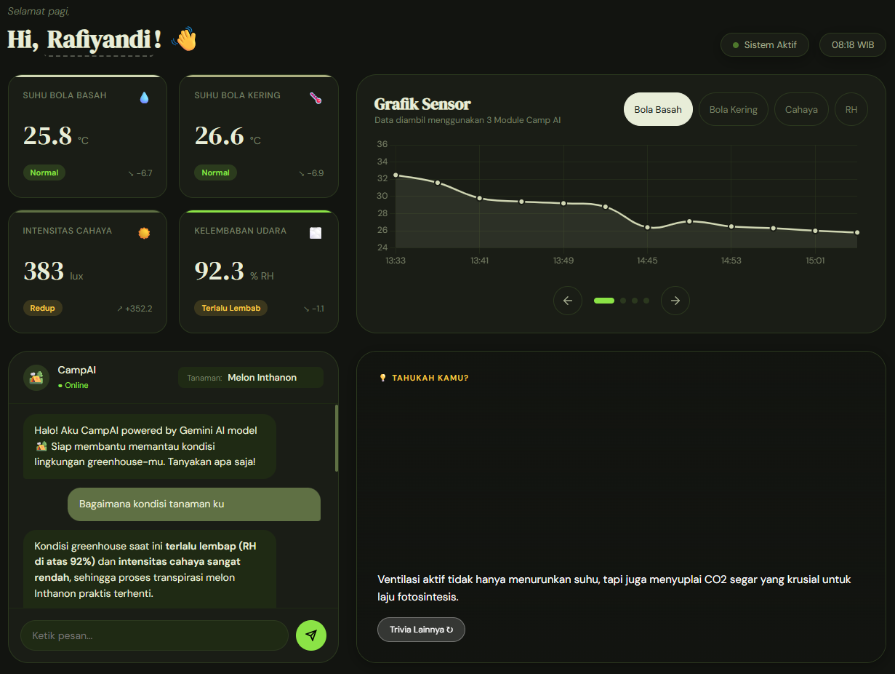
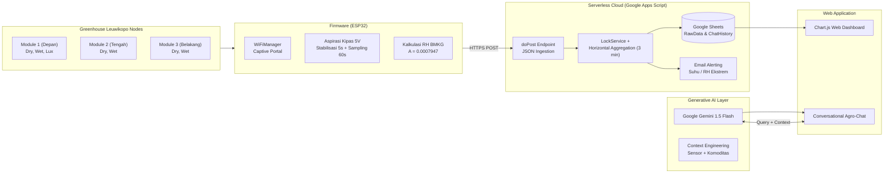

# CAMP-AI: Controlled-Atmosphere Microclimate Platform with Generative AI

<div align="center">

# 🌿 CAMP-AI (Capstone Project)
### **Departemen Teknik Mesin dan Biosistem | Fakultas Teknologi Pertanian**
### **Institut Pertanian Bogor (IPB University)**

[](https://ipb.ac.id/)
[](https://tmb.ipb.ac.id/)
[](Capstone/Firmware/Capstone.ino)
[-darkgreen.svg)](Capstone/Google%20Apps%20Script/Kode.gs)
[](Capstone/Google%20Apps%20Script/Kode.gs)
[](LICENSE)
[](https://github.com/Fluorescence-dxf/Gen-AI-Powered-Monitoring-System)

*Platform pemantauan iklim mikro presisi berbiaya rendah (low-cost) dalam lingkungan pertanian terkendali (Controlled Environment Agriculture / CEA) terintegrasi Generative AI untuk budidaya Melon Inthanon.*

---

</div>

## 👥 Tim Peneliti & Pengembang (Kelompok 2 - Capstone)

| Nama Mahasiswa | NIM | Peran Utama |
| :--- | :--- | :--- |
| **Rafiyandi Putra Pasha** | **F1401221085** | Arsitektur IoT, Firmware ESP32, Desain Enclosure 3D CAD, Integrasi Serverless GAS & Gemini AI |
| **Eliza Nurul Azhar** | **F1401221051** | Analisis Agronomi, Validasi Lapangan |
| **Dian Khairani** | **F1401221078** | Pengujian Kalibrasi Sensor, Pemodelan Psikrometrik, Analisis Ekonomi |

**Dosen Pembimbing:**
1. **Dr. Ir. Radite Praeko Agus Setiawan, M.Agr.** (NIP: 196808121993021001)
2. **Dr. Ir. Supriyanto, S.T.P., M.Kom., IPM.** (NIP: 197203251998021001)

---

## 📌 Ringkasan Proyek

**CAMP-AI** (*Controlled-Atmosphere Microclimate Platform with Artificial Intelligence*) adalah inovasi sistem pemantauan lingkungan mikroklimat presisi berbiaya rendah (*low-cost*) yang dirancang khusus untuk mengatasi keterbatasan sensor kelembapan konvensional di greenhouse tropis.

<p align="center">
  
</p>

### Keunggulan Utama:
1. **Ketahanan Kelembapan Ekstrem (>85% RH):** Menggantikan sensor kapasitif film tipis yang rentan saturasi/rusak dengan **Psikrometer Assmann aspirasi paksa** berbasis sensor suhu kedap air DS18B20 ganda (bola kering dan bola basah berventilasi).
2. **Formulasi Psikrometrik Standar BMKG:** Menghitung kelembapan relatif mengacu pada **Perka BMKG No. 04 Tahun 2026** ($A = 0.0007947 \text{ }^\circ\text{C}^{-1}$) dengan akurasi galat $\pm 2.4\%$.
3. **Arsitektur Serverless Zero-Cost:** Menggunakan **Google Apps Script** dan **Google Sheets** dengan algoritma *horizontal data grouping* multi-node (Depan, Tengah, Belakang) dalam time-window 3 menit serta mekanisme *concurrency locking*.
4. **Autonomous Agronomic Advisor:** Model fondasi **Google Gemini 1.5 Flash** yang diinjeksi konteks sensor spasial real-time untuk memberikan rekomendasi tindakan mikroklimat praktis (ventilasi, evaporative misting, shading) secara langsung kepada pengelola greenhouse.
5. **Ultra Low-Cost & High ROI:** Biaya komponen per node **< Rp 250.000** (menghemat hingga 95% dibanding stasiun cuaca industri Rp 15–40 juta) dengan *payback period* investasi kurang dari 1 siklus tanam (~70 hari).

---

## 🏗️ Diagram Alir & Arsitektur Sistem



---

## 🛠️ Matriks Kompetensi Teknis (Technical Skills)

```
┌────────────────────────────────────────────────────────────────────────┐
│                        COMPETENCY ARCHITECTURE                         │
├──────────────────────────┬─────────────────────────────────────────────┤
│ 1. Hardware & Embedded   │ • ESP32-WROOM-32 Microcontroller Architecture│
│                          │ • Bus Protocol: OneWire (DS18B20) & I2C     │
│                          │ • Sensor: Dual DS18B20 Stainless, BH1750 Lux│
│                          │ • Actuators: DC Blower Fan 5V Relay Control │
├──────────────────────────┼─────────────────────────────────────────────┤
│ 2. Cloud & IoT Software  │ • Google Apps Script (Serverless Web App)   │
│                          │ • C / C++ (ESP32 Firmware + WiFiManager)    │
│                          │ • JavaScript (ES6+), HTML5, Modern CSS3     │
│                          │ • Chart.js Interactive Time-Series Charts   │
│                          │ • REST API & JSON Payload Ingestion         │
├──────────────────────────┼─────────────────────────────────────────────┤
│ 3. Artificial Intel.     │ • Google Gemini 1.5 Flash API Integration   │
│                          │ • Context Engineering & Prompt Optimization │
│                          │ • Anomaly Detection & Microclimate Alerts   │
├──────────────────────────┼─────────────────────────────────────────────┤
│ 4. CAD & Fabrication     │ • 3D Parametric CAD Modeling                │
│                          │ • FDM 3D Printing (PLA+ Filament)           │
│                          │ • Airflow Aerodynamics & Thermal Isolation  │
├──────────────────────────┼─────────────────────────────────────────────┤
│ 5. Biosystems Science    │ • Psychrometric & Thermodynamic Modeling    │
│                          │ • Controlled Environment Agriculture (CEA)  │
│                          │ • Precision Horticulture (Melon Inthanon)   │
└──────────────────────────┴─────────────────────────────────────────────┘
```

---

## 📂 Struktur Repositori

```
    Gen-AI-Powered-Monitoring-System/
    ├── Capstone/                              # Direktori Utama Proyek CAMP-AI
    │   ├── README.md                          # Dokumentasi teknis mendalam CAMP-AI
    │   ├── Firmware/                          # Kode Firmware Mikrokontroler
    │   │   ├── Capstone.ino                   # Firmware ESP32 (BMKG Psychrometer + WiFiManager)
    │   │   └── config.h.example              # Template konfigurasi node sensor
    │   ├── Desain/                            # Berkas 3D CAD Enclosure siap cetak (STL)
    │   │   ├── Bagian Atas_Capstone.stl
    │   │   ├── Bagian Bawah_Capstone.stl
    │   │   └── Laci_Capstone.stl
    │   ├── Dokumentasi/                       # Berkas Laporan PDF, Poster, & Foto
    │   │   ├── dashboard.png                  # Tangkapan layar web dashboard
    │   │   ├── Team.png                       # Foto tim
    │   │   ├── Team1.png                      # Foto tim (alternatif)
    │   │   ├── K2P2_Kelompok 2_CAMP-AI.pdf    # Laporan lengkap Capstone
    │   │   └── Poster K2P2.pdf               # Poster ilmiah Capstone
    │   └── Google Apps Script/                # Backend Serverless & Dashboard Frontend
    │       ├── Kode.gs                        # Ingestion horisontal, Concurrency Lock, Gemini
    AI
    │       ├── Index.html                     # Antarmuka web dashboard responsif
    │       ├── CSS.html                       # Desain tema agronomi modern
    │       └── JS.html                        # Interaktivitas client & rendering Chart.js
    ├── .github/                               # GitHub CI/CD & Templates
    │   ├── workflows/ci.yml                   # GitHub Actions CI pipeline
    │   ├── ISSUE_TEMPLATE/                    # Template issue (bug & feature)
    │   └── PULL_REQUEST_TEMPLATE.md           # Template pull request
    ├── .gitignore                             # Git ignore untuk Arduino, IDE, & OS artifacts
    ├── .gitattributes                         # Konfigurasi atribut file Git
    ├── CODE_OF_CONDUCT.md                     # Kode etik kontributor
    ├── CONTRIBUTING.md                        # Panduan kontribusi
    ├── LICENSE                                # Lisensi MIT
    └── README.md                              # Portofolio Utama Repositori
```

---

## 🚀 Panduan Cepat Memulai (Quick Start)

### 1. Flash Firmware Node ESP32
1. Buka berkas [`Capstone/Capstone.ino`](Capstone/Firmware/Capstone.ino) pada Arduino IDE.
2. Pasang pustaka pendukung: `DallasTemperature`, `OneWire`, `BH1750`, dan `WiFiManager`.
3. Sesuaikan `SCRIPT_URL` dengan URL deployment Google Apps Script Anda.
4. Pilih identitas modul (`Module1`, `Module2`, atau `Module3`).
5. Unggah ke board ESP32. Sambungkan ke WiFi Access Point `CAMP-AI_ModuleX` untuk konfigurasi koneksi jaringan.

### 2. Deploy Google Apps Script
1. Buat proyek baru di [Google Apps Script](https://script.google.com/).
2. Salin isi berkas dari [`Capstone/Google Apps Script/`](Capstone/Google%20Apps%20Script/):
   - `Kode.gs`, `Index.html`, `CSS.html`, `JS.html`.
3. Tambahkan `GEMINI_API_KEY` pada **Project Settings** $\rightarrow$ **Script Properties**.
4. Jalankan fungsi `setup()` sekali di `Kode.gs` untuk menginisialisasi database Spreadsheet.
5. Klik **Deploy** $\rightarrow$ **New Deployment** (Tipe: *Web App*, Akses: *Anyone*).

👉 **[Baca Dokumentasi Lengkap CAMP-AI di Capstone/README.md →](Capstone/README.md)**

---

## 🎓 Afiliasi Akademik & Kontak

- **Institusi:** Departemen Teknik Mesin dan Biosistem, Fakultas Teknologi Pertanian, Institut Pertanian Bogor (IPB University)
- **Kampus:** IPB Dramaga, Bogor, Jawa Barat 16680, Indonesia
- **Surel Akademik:** `rafiyandi@apps.ipb.ac.id`

---

## 📜 Lisensi

Seluruh kode sumber dan desain dalam repositori ini dipublikasikan di bawah lisensi [MIT License](LICENSE). Anda dipersilakan menggunakannya untuk keperluan riset ilmiah, tugas akhir, dan pengembangan pertanian presisi terbuka.
